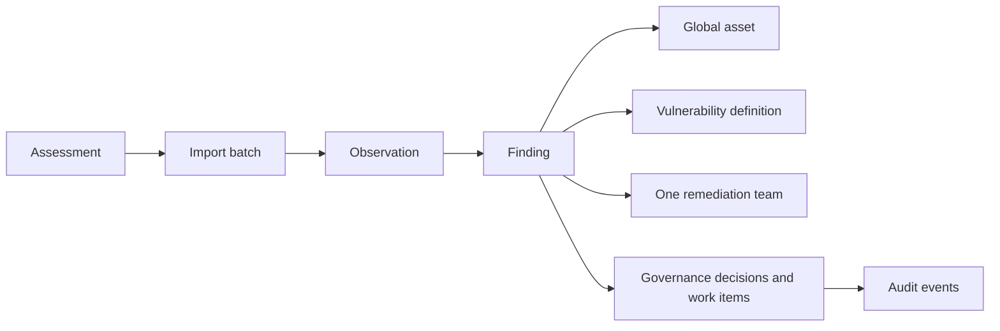

# Arbitrator architecture

## Core system

FastAPI HTTP routes and Jinja2 templates render a server-side web application backed by SQLAlchemy and SQLite. Business workflows are separated across importer normalization, asset identity, correlation suggestions, finding responsibility, governance decisions and integration clients.

**Invariant:** assets are organization-wide, not engagement-owned. Assessment and engagement context reaches a finding through observations linked to import batches. Each tracked finding references one asset and one source-scoped vulnerability definition, and has zero or one accountable remediation team. An unassigned finding stays in triage. A team can be selected by global matching rule or analyst action. These are different from governance decision makers and user access roles.

## Boundaries and data provenance

Importers return structured `FindingInput` rows and preserve source metadata. Reimporting the same file into the same assessment is idempotent; later assessments can reobserve an existing tracked issue without automatically marking it fixed. Cross-source candidate correlation is **advisory**, based on same-asset and CVE/title evidence; no automatic merge occurs. IP/FQDN aliases do not prove asset identity, and a hostname alone does not prove public reachability.

Source-facing functionality: `app/importers.py`, `app/source_adapters.py`, `app/connectors.py`, `app/servicenow.py`. Domain/business operations: `app/models.py`, `app/services.py`, `app/routing.py`, `app/workflows.py`, `app/governance_tasks.py`, `app/correlation.py`. Views/controls: `app/main.py`, `app/templates`, `app/static`.

## Security boundary

Login sessions and custom RBAC permissions are checked server-side. Mutating routes require CSRF protection. Connector credentials are encrypted using a server-managed key; no real credentials are bundled. Provider operations should be executed only in authorized environments. The SQLite application lacks production-grade migration support, mature observability, independent penetration testing and deployment hardening. Do not infer those from a passing unit suite.
