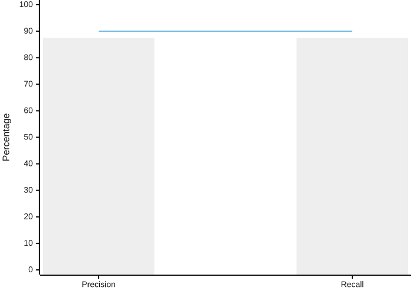

# Arbitrator Architecture

## Core System

Arbitrator is a modular web application built using FastAPI, Jinja2,
SQLAlchemy and SQLite.

Business workflows are separated across importer normalization,
asset identity, correlation suggestions, finding responsibility,
governance decisions and integration clients.

## System Architecture

[Mermaid source](diagrams/system-architecture.mmd)

The application separates presentation, access control, domain
services and persistence within a modular monolith.

External integrations are optional and are not required for the
core assessment management workflow.

## Domain Model

[Mermaid source](diagrams/domain-model.mmd)

Assets are organization-wide, not engagement-owned. Assessment
and engagement context reaches a finding through observations
linked to import batches.

Each tracked finding references:

- One global asset.
- One source-scoped vulnerability definition.
- Zero or one accountable remediation team.
- Associated assessment observations.
- Governance decisions and work items.

An unassigned finding stays in triage. A remediation team can
be selected by a global matching rule or analyst action.

Remediation teams, governance decision makers and user access
roles represent distinct responsibilities.

## Assessment Data Flow

[Mermaid source](diagrams/assessment-data-flow.mmd)

Importers return structured FindingInput rows and preserve
source metadata.

Reimporting the same file into the same assessment is
idempotent. Later assessments can reobserve an existing
tracked issue without automatically marking it fixed.

Cross-source candidate correlation is advisory, based on
same-asset and CVE/title evidence. No automatic merging occurs.

IP/FQDN aliases do not prove asset identity, and a hostname
alone does not prove public reachability.

## Application Components

| Component | Source |
|---|---|
| Import processing | app/importers.py |
| Source adapters | app/source_adapters.py |
| Data models | app/models.py |
| Domain services | app/services.py |
| Correlation | app/correlation.py |
| Ownership routing | app/routing.py |
| Governance workflows | app/workflows.py |
| Governance work items | app/governance_tasks.py |
| Authentication | app/auth.py |
| Integration clients | app/connectors.py |
| ServiceNow integration | app/servicenow.py |
| Persistence | app/database.py |
| Web application | app/main.py |
| Presentation | app/templates/ |
| Static resources | app/static/ |

## Security Boundary

Login sessions and custom RBAC permissions are checked
server-side. Mutating routes require CSRF protection.

Connector credentials are encrypted using a server-managed
key. No real credentials are bundled.

Provider operations should be executed only in authorized
environments.

The SQLite application lacks production-grade migration
support, mature observability, independent penetration
testing and deployment hardening. These capabilities must
not be inferred from a passing automated test suite.

## Preliminary Evaluation

[Mermaid source](diagrams/candidate-matching-results.mmd)

The preliminary synthetic benchmark reports:

| Metric | Result |
|---|---:|
| Finding instances | 1,000 |
| Labeled comparisons | 500 |
| Precision | 87.5% |
| Recall | 87.5% |
| F1 score | 87.5% |
| Precision and recall target | 90% |

These measurements describe advisory candidate-matching
performance under controlled synthetic conditions.

They do not establish production accuracy or organizational
risk reduction.

See [VALIDATION.md](VALIDATION.md) for validation methodology,
documented results and limitations.

## Related Documentation

- [Import Formats](IMPORT_FORMATS.md)
- [Data Management](DATA_MANAGEMENT.md)
- [Validation](VALIDATION.md)
- [Diagram Sources](diagrams/)

